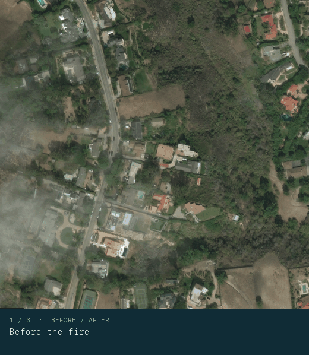
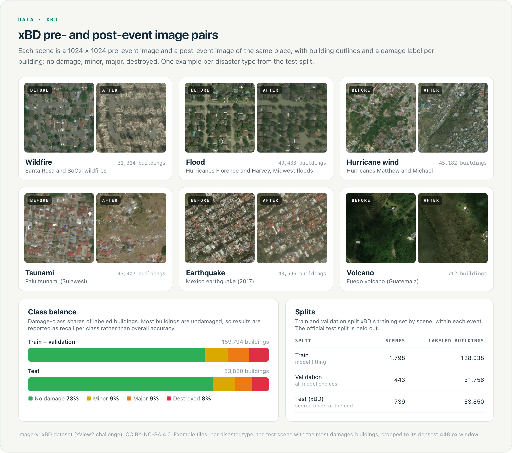
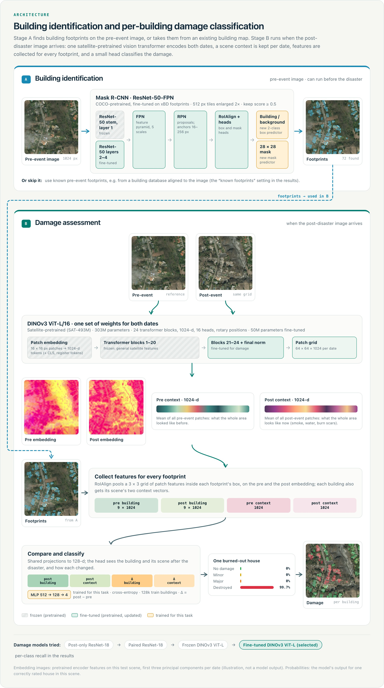
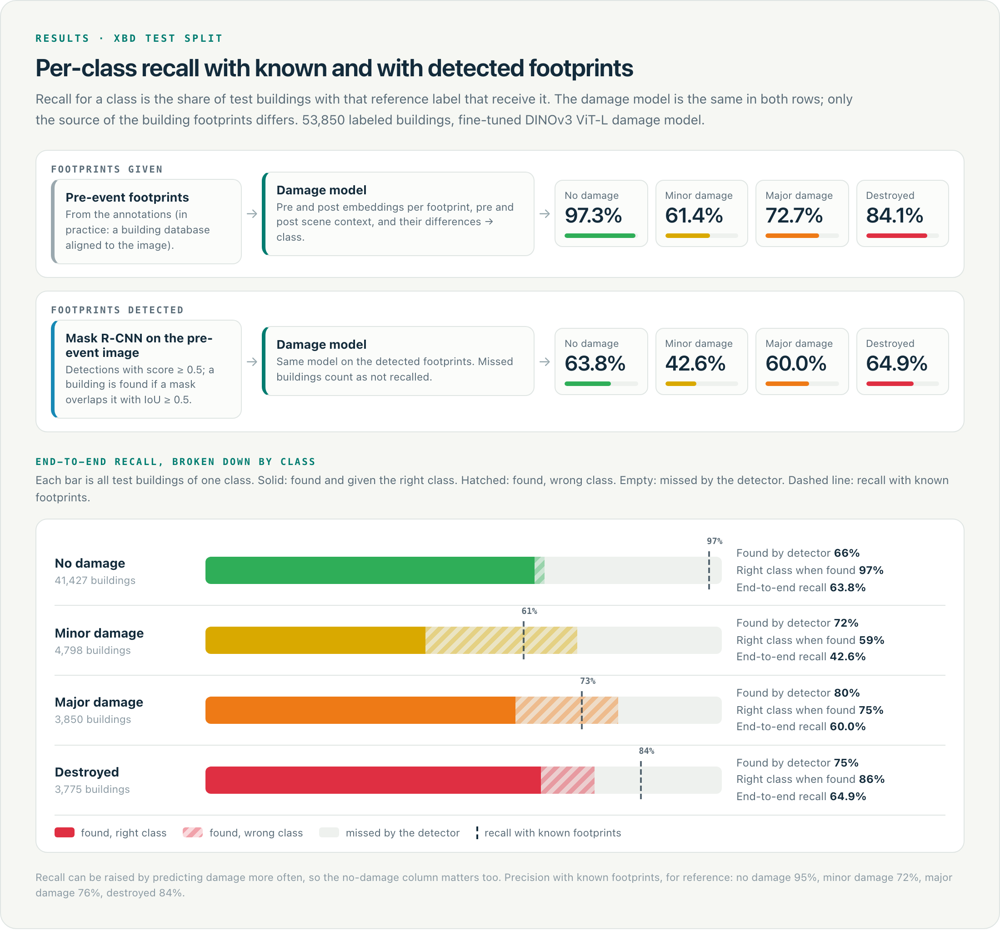
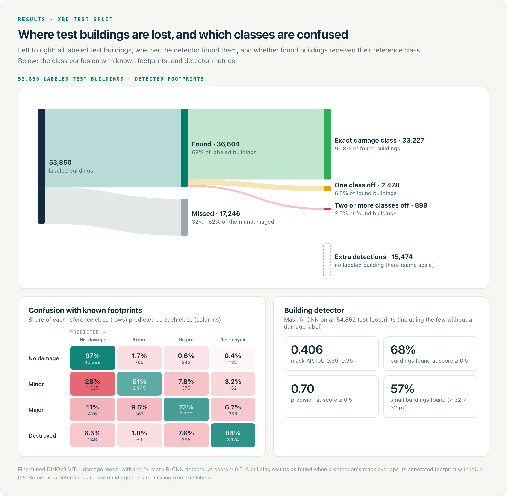
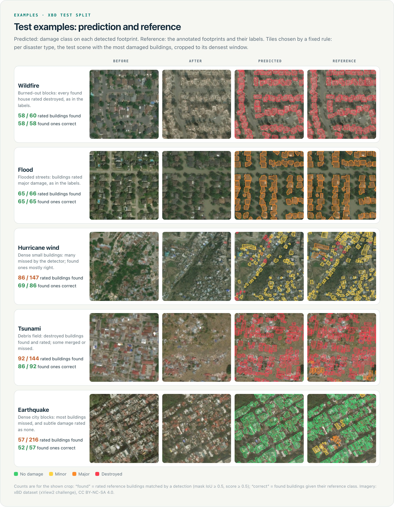
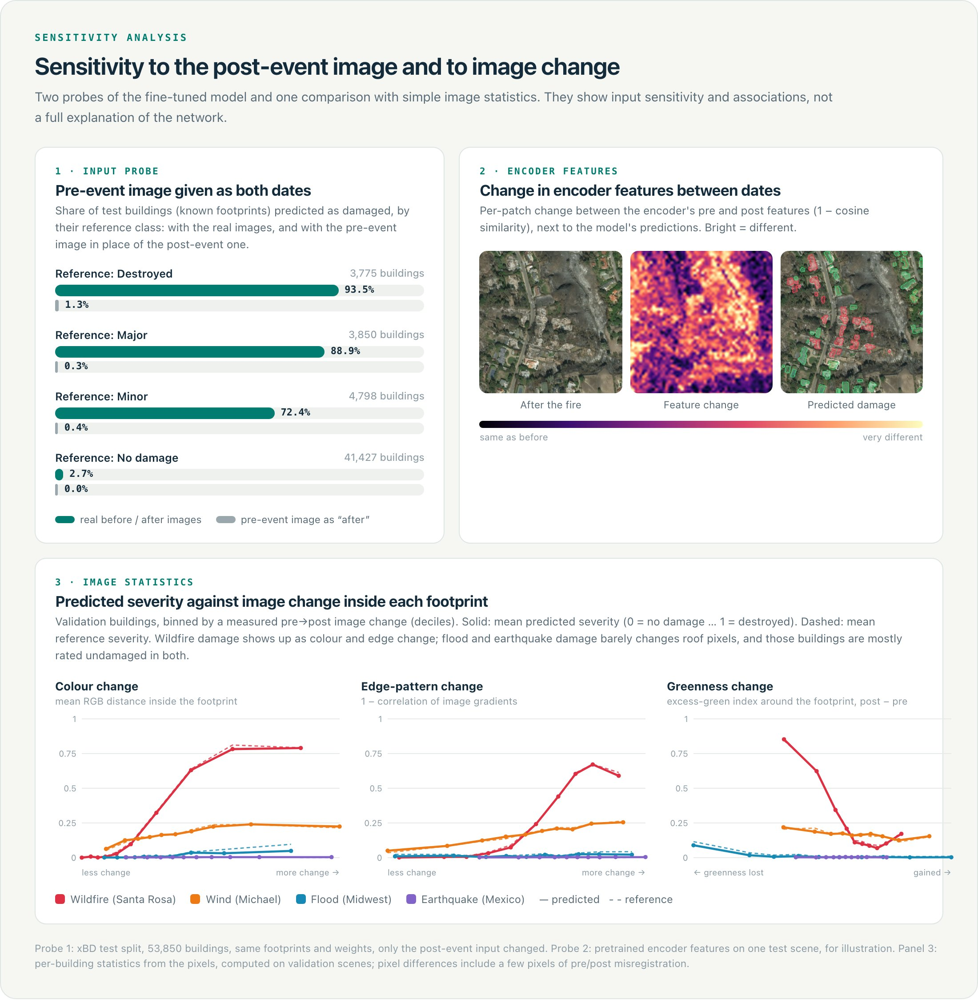
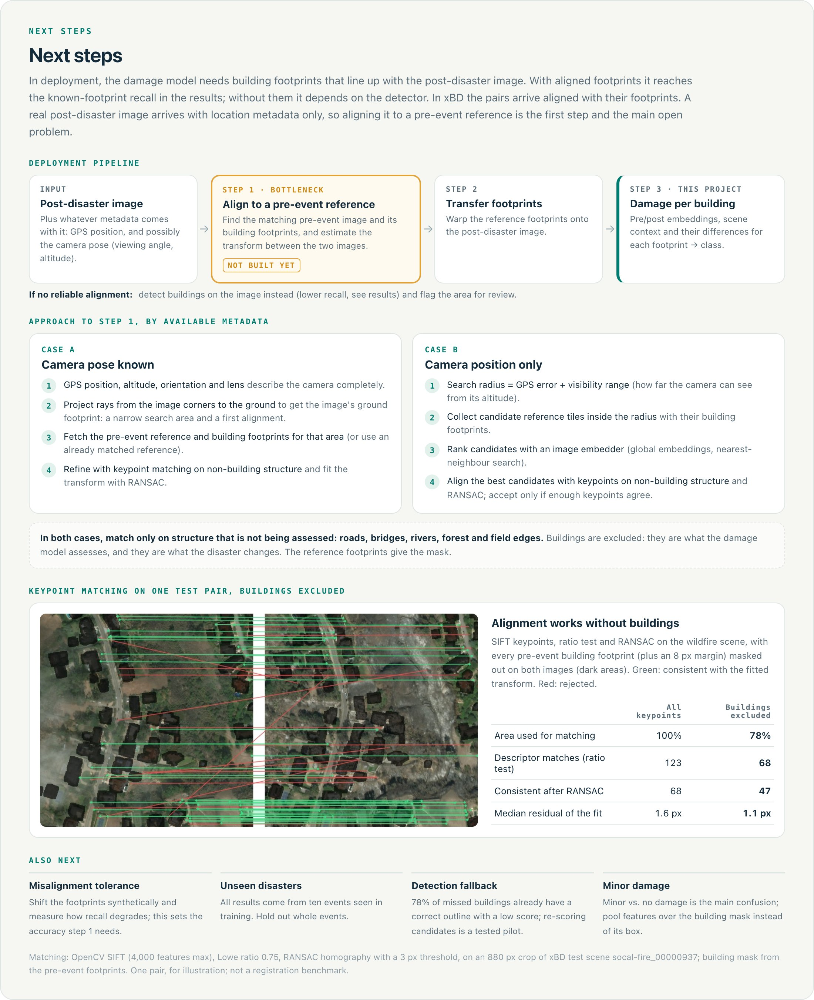

# DisasterLens

Building damage assessment from satellite images taken before and after a disaster. For every building, the model
predicts one of the four xBD damage classes: **no damage, minor damage, major damage, destroyed**.

<p align="center"></p>

Recall per damage class on the xBD test split (53,850 labeled buildings): the share of buildings of each class that
receive that class.

| Footprints | No damage | Minor | Major | Destroyed |
| --- | ---: | ---: | ---: | ---: |
| Known (pre-event building outlines given) | 97.3% | 61.4% | 72.7% | 84.1% |
| Detected (Mask R-CNN, then the same damage model) | 63.8% | 42.6% | 60.0% | 64.9% |

The difference between the two rows comes mostly from buildings the detector misses: among buildings it finds, recall
is 97% / 59% / 75% / 86%. All model choices were made on a validation split; the test split was scored once.

## 1. Task

After a hurricane, flood or wildfire, responders need to know which buildings are damaged. Satellites image the area
before and after the event. The task here is to assign one damage class to each building from the two images, either
with known building footprints or by detecting the buildings first.

## 2. Data

<p align="center"></p>

[xBD](https://xview2.org/dataset) provides pre- and post-event satellite images (1024 × 1024 px) with building
outlines and a damage label per building. Its train and test splits, used here, cover ten disasters. 73% of labeled
buildings are undamaged, so results are reported as recall per class rather than overall accuracy.

## 3. Model

<p align="center"></p>

Two stages, run at different times.

**A. Building identification (pre-event image).** Mask R-CNN with a ResNet-50-FPN backbone, starting from COCO
weights: ResNet-50 → feature pyramid → region proposals → RoIAlign → box head (building vs. background) and mask head
(28 × 28 mask per building). The ResNet stem and first stage stay frozen; stages 2–4, the pyramid, the proposal network
and both heads are fine-tuned on xBD footprints, with new two-class predictors. Two thirds of all buildings cover less
than 32 × 32 px, so the detector is trained and run on 512 px tiles enlarged 2×; on validation this raised mask AP
from 0.343 to 0.405 and small-building recall from 44% to 58%. With an existing building map, this stage is skipped.

**B. Damage assessment (when the post-disaster image arrives).**
- Both dates are encoded by one DINOv3 ViT-L/16, pretrained on satellite imagery (SAT-493M): 16 × 16 px patches →
  24 transformer blocks (1024-d, 16 heads, rotary positions) → a 64 × 64 grid of 1024-d patch embeddings per date.
  Blocks 1–20 stay frozen; blocks 21–24 and the final norm (50M of 303M parameters) are fine-tuned.
- A scene context is kept per date: the mean of all patch embeddings of the pre- and of the post-event image.
- For each footprint, RoIAlign pools a 3 × 3 grid of patch embeddings on both dates.
- Shared projections to 128-d, then a small MLP (trained for this task) classifies
  **[post building, post context, post − pre building, post − pre context]**.

Damage models tried, with known footprints on the test split:

| Damage model | No damage | Minor | Major | Destroyed |
| --- | ---: | ---: | ---: | ---: |
| Post-image-only ResNet-18 (frozen, linear head) | 85.8% | 62.2% | 70.8% | 67.4% |
| Paired ResNet-18 (frozen, fusion head) | 96.8% | 40.7% | 67.7% | 75.8% |
| Frozen DINOv3 ViT-L (fusion head) | 97.6% | 51.1% | 74.6% | 84.2% |
| **Fine-tuned DINOv3 ViT-L** (selected) | **97.3%** | **61.4%** | **72.7%** | **84.1%** |

The post-image-only baseline reaches its minor-damage recall by labeling 14% of undamaged buildings as damaged.
Among the models that keep no-damage recall above 96%, the fine-tuned ViT has the highest minor-damage recall. Models
were selected on validation macro-F1 (the mean of the per-class F1 scores).

## 4. Results

<p align="center"></p>

- With known footprints, recall is 97% for no damage, 61% for minor, 73% for major and 84% for destroyed.
- With detected footprints, most of the loss comes from missed buildings. The detector finds 66% of undamaged and
  72–80% of damaged buildings; among the buildings it finds, recall per class is close to the known-footprint values.
- Minor damage is the hardest class: 28% of minor-damage buildings are predicted as undamaged.
- Precision with known footprints, for reference: no damage 95%, minor 72%, major 76%, destroyed 84%.

<p align="center"></p>

<p align="center"></p>

## 5. Sensitivity analysis

<p align="center"></p>

- With the pre-event image given as both dates, the share of buildings predicted as damaged drops from 93.5% to 1.3%
  for destroyed, 88.9% to 0.3% for major and 72.4% to 0.4% for minor. The predictions depend on the post-event image,
  not on the pre-event appearance of the area.
- For wildfires, predicted severity increases with colour and edge change inside the footprint and with lost
  vegetation around it, in line with the labels. Flood and earthquake damage changes few roof pixels, and predicted
  severity barely moves with these measures there.

These are input probes and associations, not a complete explanation of the network.

## 6. Next steps

<p align="center"></p>

**Alignment is the first step of a deployment pipeline and the main open problem.** The damage model needs building
footprints that line up with the post-disaster image. In xBD, image pairs arrive aligned with their footprints. A real
post-disaster image arrives with location metadata only, so it first has to be aligned to a pre-event reference with
building footprints; then the reference footprints are transferred and the damage model runs on them. If no reliable
alignment is found, the detector is the fallback, at the lower recall shown above.

The approach depends on the available metadata:

1. **Camera pose known** (GPS position, altitude, orientation, lens). Project rays from the image corners to the
   ground to get the image's ground footprint. This narrows the search to a small area and gives a first alignment;
   fetch the pre-event reference and building footprints for that area, then refine with keypoint matching and RANSAC.
2. **Camera position only.** The search radius is the GPS error plus the visibility range (how far the camera can see
   from its altitude). Collect candidate reference tiles inside it, rank them with an image embedder (nearest-neighbour
   search on global embeddings), and align the best candidates with keypoint matching and RANSAC, accepting a match
   only if enough keypoints agree.

In both cases, keypoints should come from structure that is not being assessed: roads, bridges, rivers, forest and
field edges. Buildings are excluded, because they are what the damage model assesses and what the disaster changes;
the reference footprints provide the mask. On the wildfire test pair above, SIFT matching with all building footprints
masked out (22% of the image) still finds 47 consistent matches after RANSAC, on roads and open ground, with a median
residual of 1.1 px.

Other next steps:
- **Misalignment tolerance:** shift the footprints synthetically and measure how recall degrades; this sets the
  accuracy the alignment step needs.
- **Unseen disasters:** all results come from ten events seen in training; hold out whole events.
- **Detection fallback:** 78% of missed buildings already have a correct outline with a low confidence score; a pilot
  that re-scores detections with ViT features improved validation results.
- **Minor damage:** pool features over the building mask instead of its box.
- One training run per model; labels describe what is visible from above, not structural safety.

## Repository layout

```
src/disaster_lens/
  data/        xBD extraction, building manifest, scene-grouped split, building index, footprint rasterization, datasets
  damage/      encoders (ResNet-18, DINOv3 ViT-L), feature cache, heads, DamageClassifier, trainers, exports, predictors
  detection/   Mask R-CNN, compact masks, crop training, tiled inference, trainer/exporter, metrics, COCO weights,
               candidate re-scoring (verifier pilot)
  end_to_end/  damage predictions on detected and annotated footprints, scoring, no-change probe
modal_app.py   runs any stage on a Modal L4 GPU
assets/        README figures
tests/         CPU unit and workflow tests on synthetic data
```

Damage classifiers are defined by three choices, and any combination trains with one command:

| Choice | Options |
| --- | --- |
| `--encoder` | `resnet18`, `dinov3-vitl` |
| `--inputs` | `post` (post-event image only), `paired` (pre + post) |
| `--trainable-blocks` | `0` (frozen encoder, train the head) or `N` (also train the last N encoder blocks) |

## Setup

Requires Python 3.14 and [uv](https://docs.astral.sh/uv/).

```bash
uv sync --group vit                       # timm for DINOv3; add --group cloud for Modal
```

**Data.** Download the xBD train and test archives from the [official portal](https://xview2.org/download) into
`datasets/`. xBD is licensed under CC BY-NC-SA 4.0 and is not included here.

```bash
uv run python -m disaster_lens.data.extract --splits train test
uv run python -m disaster_lens.data.manifest --split train                 # labeled buildings
uv run python -m disaster_lens.data.split --seed 42                        # scene-grouped train/validation split
uv run python -m disaster_lens.data.building_index --data-dir datasets \
    --assignments datasets/processed/splits/seed42/scene_assignments.csv \
    --output-dir datasets/processed/localization/seed42-v1                 # all pre-event footprints per scene
uv run python -m disaster_lens.data.manifest --split test                  # test: labeled buildings
uv run python -m disaster_lens.data.building_index --source-split test     # test: footprints (localization/test-v1)
```

**Pretrained weights.** ResNet-18 comes from torchvision. The others are local files:

```bash
uv run python -m disaster_lens.detection.weights                          # COCO Mask R-CNN, writes provenance.json
uvx hf download timm/vit_large_patch16_dinov3.sat493m --revision ce148bd5ed3de1eb75ebdccafcb2c280bb3e8f7c \
    --local-dir datasets/pretrained/dinov3-vitl16-sat                      # DINOv3 (accept its license on Hugging Face)
```

## Reproduce

Commands below run locally (`--device cuda` on a GPU); every stage also has a Modal workflow (`modal run --detach modal_app.py::<workflow>`; see
the docstring of `modal_app.py`). Runs never overwrite an existing output directory.

**Damage models** (`S=datasets/processed/splits/seed42`, `V=datasets/pretrained/dinov3-vitl16-sat`):

```bash
# Post-only baseline: frozen ResNet-18, linear head on the post-event image
python -m disaster_lens.damage.train_live train --encoder resnet18 --inputs post --trainable-blocks 0 \
    --head-lr 0.001 --data-dir datasets --split-dir $S --output-dir runs/post-only --device cuda

# Paired CNN and frozen ViT: cache frozen features once, then train the fusion head on them
python -m disaster_lens.damage.feature_cache --encoder resnet18 --cache-dir runs/features/resnet18 --batch-size 8 --device cuda
python -m disaster_lens.damage.train_cached --train-cache runs/features/resnet18/train \
    --validation-cache runs/features/resnet18/validation --output-dir runs/paired-cnn --batch-size 8 --device cuda
python -m disaster_lens.damage.feature_cache --encoder dinov3-vitl --encoder-dir $V --cache-dir runs/features/dinov3 --device cuda
python -m disaster_lens.damage.train_cached --train-cache runs/features/dinov3/train \
    --validation-cache runs/features/dinov3/validation --output-dir runs/frozen-vit --batch-size 8 --device cuda

# Fine-tuned ViT: start from the frozen ViT head and also train the last 4 blocks
python -m disaster_lens.damage.train_live train --encoder dinov3-vitl --encoder-dir $V --inputs paired \
    --trainable-blocks 4 --init-head runs/frozen-vit/best.pt --precision bf16 \
    --data-dir datasets --split-dir $S --output-dir runs/fine-tuned-vit --device cuda

# Validation predictions
python -m disaster_lens.damage.export_cached --run-dir runs/paired-cnn --validation-cache runs/features/resnet18/validation
python -m disaster_lens.damage.train_live export --run-dir runs/fine-tuned-vit --data-dir datasets --manifest $S/validation.csv
```

**Detector** (`I=datasets/processed/localization/seed42-v1`; SHA-256 from the weights' `provenance.json`):

```bash
python -m disaster_lens.detection.train train --fresh-training --coco-weights datasets/pretrained/maskrcnn-resnet50-fpn-coco-v1/weights.pt \
    --weights-sha256 $SHA --epochs 5 --index-dir $I --output-dir runs/detector --device cuda
python -m disaster_lens.detection.train train --resume-from runs/detector --resume-checkpoint best --additional-epochs 1 \
    --allow-protocol-change --crop-size 512 --crops-per-scene 4 --validation-subset 100 --validation-tile-size 512 \
    --index-dir $I --output-dir runs/detector-2x --device cuda
python -m disaster_lens.detection.train export --run-dir runs/detector-2x --tile-size 512 --index-dir $I --device cuda
```

**End to end** (both scenarios in one pass, then scoring):

```bash
python -m disaster_lens.end_to_end.run --checkpoint runs/fine-tuned-vit/best.pt \
    --saved-predictions runs/fine-tuned-vit/validation_predictions/predictions.csv \
    --manifest $S/validation.csv --data-dir datasets --export-dir runs/detector-2x/validation_predictions_tile512 \
    --output-dir runs/end-to-end --device cuda
python -m disaster_lens.end_to_end.score --run-dir runs/end-to-end --output runs/end-to-end/scores.json
```

The end-to-end run first checks that the damage model reproduces its own recorded validation results on the
annotated footprints and stops if it does not. For a cached-feature head (paired CNN, frozen ViT) pass the head's
`best.pt` and, for DINOv3, `--encoder-dir`.

**Test split** (once, after all choices are made). The export refuses test scenes that overlap the detector's
training or validation scenes; the test split has no recorded damage predictions, so the reference check is skipped:

```bash
python -m disaster_lens.detection.train export --run-dir runs/detector-2x --split test --tile-size 512 \
    --index-dir datasets/processed/localization/test-v1 --device cuda
python -m disaster_lens.end_to_end.run --checkpoint runs/fine-tuned-vit/best.pt --skip-reference-check \
    --manifest datasets/processed/test_buildings.csv --data-dir datasets \
    --export-dir runs/detector-2x/test_predictions_tile512 --output-dir runs/end-to-end-test --device cuda
```

## Tests

```bash
uv run --group vit --group cloud python -m unittest discover -s tests
```

Tests run on CPU with synthetic images and tiny models: every encoder × inputs × trainable-blocks combination,
detector training/export/tiling, end-to-end runs and scoring, and the Modal runner (without Modal calls).

## License

Code: MIT (see `LICENSE`); `LICENSES/` holds third-party notices (torchvision-derived Mask R-CNN code,
BSD-3-Clause). Data: xBD, CC BY-NC-SA 4.0, not included. The figures in `assets/` contain xBD imagery and labels and
are shared under CC BY-NC-SA 4.0 (see `LICENSES/xBD-imagery.md`). DINOv3 weights are subject to Meta's DINOv3
license.

xBD: Gupta et al., *xBD: A Dataset for Assessing Building Damage from Satellite Imagery*, CVPR Workshops 2019.
