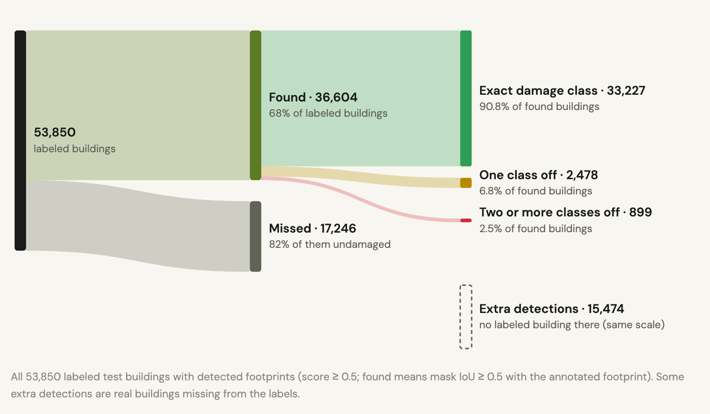
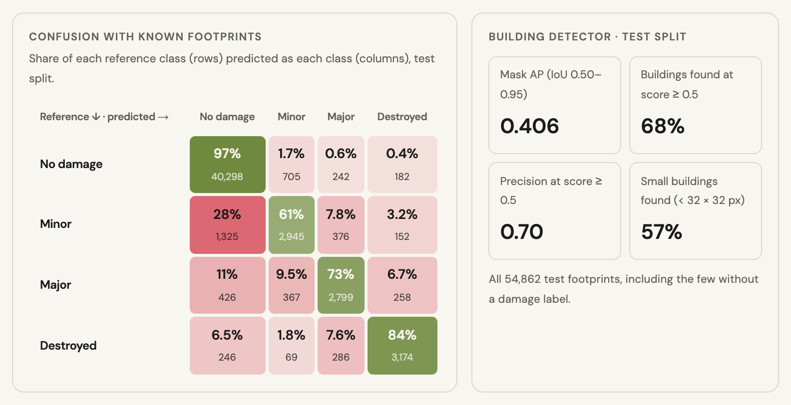

# DisasterLens

DisasterLens assigns one of the four xBD damage classes to every building in a pair of satellite images taken before
and after a disaster: no damage, minor damage, major damage or destroyed.

<p align="center"></p>

**Recall per damage class · xBD test split · 53,850 buildings**

| Footprints | No damage | Minor | Major | Destroyed |
| --- | ---: | ---: | ---: | ---: |
| **Known footprints** (pre-event building outlines given) | 97.3% | 61.4% | 72.7% | 84.1% |
| **Detected footprints** (Mask R-CNN, then the same damage model) | 63.8% | 42.6% | 60.0% | 64.9% |

Recall for a class: the share of buildings with that reference label that receive it. Same damage model in both rows;
only the source of the footprints differs.

The difference between the two rows comes mostly from buildings the detector misses: among the buildings it finds,
recall per class is 97% / 59% / 75% / 86%. All model choices were made on a validation split; the test split was
scored once.

## Task

After a hurricane, flood or wildfire, responders need to know which buildings are damaged. Satellites image the area
before and after the event. The task here is to assign one damage class to each building from the two images, either
with known building footprints or by detecting the buildings first.

## Data

[xBD](https://xview2.org/dataset) ([Gupta et al., 2019](https://arxiv.org/abs/1911.09296)) provides pre- and
post-event satellite images (1024 × 1024 px) with building outlines and a damage label per building. Its train and
test splits, used here, cover ten disasters. 73% of labeled buildings are undamaged, so results are reported as recall
per class rather than overall accuracy.

<p align="center"></p>

## Model

Two stages, run at different times.

<p align="center"></p>

### Building identification

[Mask R-CNN](https://arxiv.org/abs/1703.06870) with a ResNet-50-FPN backbone, starting from COCO weights: ResNet-50 →
feature pyramid → region proposals → RoIAlign → box head (building vs. background) and mask head (28 × 28 mask per
building). The ResNet stem and first stage stay frozen; stages 2–4, the pyramid, the proposal network and both heads
are fine-tuned on xBD footprints, with new two-class predictors. The training loss is the standard Mask R-CNN sum,
with equal weights: proposal objectness (binary cross-entropy) and box offsets (smooth L1), building vs. background
(cross-entropy) and box refinement (smooth L1), and the per-pixel mask loss (binary cross-entropy).

Two thirds of all buildings cover less than 32 × 32 px, so the detector is trained and run on 512 px tiles enlarged
2×. On validation this raised mask AP from 0.343 to 0.405 and small-building recall from 44% to 58%. With an existing
building map, this stage is skipped.

### Damage assessment

- Both dates are encoded by one [DINOv3](https://github.com/facebookresearch/dinov3) ViT-L/16, pretrained on
  satellite imagery (SAT-493M): 16 × 16 px patches → 24 transformer blocks → a 64 × 64 grid of 1024-d patch
  embeddings per date. Blocks 1–20 stay frozen; blocks 21–24 and the final norm (50M of 303M parameters) are
  fine-tuned.
- A scene context is kept per date: the mean of all patch embeddings of the pre- and of the post-event image.
- For each footprint, RoIAlign pools a 3 × 3 grid of patch embeddings on both dates. With the two scene contexts,
  each building has four raw vectors: pre building, post building, pre context, post context.
- Each is projected to 128-d, and a small MLP (512 → 128 → 4) classifies
  **[post building, post context, Δ building, Δ context]**, where Δ = post − pre. The pre-event features enter only
  through the two Δ terms. The loss is cross-entropy over the four damage classes, unweighted.

### Damage models tried

Recall per class with known footprints, test split:

| Damage model | No damage | Minor | Major | Destroyed |
| --- | ---: | ---: | ---: | ---: |
| Post-image-only ResNet-18 (frozen, linear head) | 85.8% | 62.2% | 70.8% | 67.4% |
| Paired ResNet-18 (frozen, fusion head) | 96.8% | 40.7% | 67.7% | 75.8% |
| Frozen DINOv3 ViT-L (fusion head) | 97.6% | 51.1% | 74.6% | 84.2% |
| **Fine-tuned DINOv3 ViT-L** (selected) | **97.3%** | **61.4%** | **72.7%** | **84.1%** |

The post-image-only baseline reaches its minor-damage recall by labeling 14% of undamaged buildings as damaged.
Among the models that keep no-damage recall above 96%, the fine-tuned ViT has the highest minor-damage recall.
Models were selected on validation macro-F1 (the mean of the per-class F1 scores).

## Results

### Per-class recall

With known footprints, recall is 97% for no damage, 61% for minor, 73% for major and 84% for destroyed. With detected
footprints, most of the loss comes from missed buildings: the detector finds 66% of undamaged and 72–80% of damaged
buildings, and among the buildings it finds, recall per class is close to the known-footprint values.

<p align="center"></p>

### Where buildings are lost

<p align="center"></p>

### Class confusion and detection

Minor damage is the hardest class: 28% of minor-damage buildings are predicted as undamaged.

<p align="center"></p>

### Examples

<p align="center"></p>

For comparison, the damage baseline in the xBD paper, which also classifies given building polygons, reports recall of
53% / 11% / 0.5% / 43% for the four classes. The xView2 challenge winners were much stronger, but they were scored on
a pixel-level metric ([first-place solution](https://github.com/DIUx-xView/xView2_first_place)), which is not directly
comparable to these per-building numbers.

## Sensitivity analysis

- With the pre-event image given as both dates, the share of buildings predicted as damaged drops from 93.5% to 1.3%
  for destroyed, 88.9% to 0.3% for major and 72.4% to 0.4% for minor. The predictions depend on the post-event image,
  not on the pre-event appearance of the area.
- Δ features, the per-patch change in the encoder's features between the two dates (1 − cosine similarity), is large
  over the burned houses and hillside of the wildfire scene and small over the intact houses at its edges. The
  classifier's Δ inputs (post − pre) carry the same kind of signal for each building.
- For wildfires, predicted severity increases with colour and edge change inside the footprint and with lost
  vegetation around it, in line with the labels. Flood and earthquake damage changes few roof pixels, and predicted
  severity barely moves with these measures there.

<p align="center"></p>

## Next steps

Alignment is the first step of a deployment pipeline and the main open problem. The damage model needs building
footprints that line up with the post-disaster image. In xBD, image pairs arrive aligned with their footprints; the
dataset authors corrected post-event offsets per event. A real post-disaster image arrives with location metadata
only, so it first has to be aligned to a pre-event reference with building footprints. Then the reference footprints
are transferred and the damage model runs on them. Without a reliable alignment, the detector is the fallback, at the
lower recall shown above.

<p align="center"></p>

The approach depends on the available metadata. With the camera pose known (GPS position, altitude, orientation,
lens), rays projected from the image corners to the ground give the image's ground footprint, which narrows the search
and gives a first alignment. With only a camera position, the search radius is the GPS error plus the visibility
range; candidate reference tiles are ranked with an image embedder and aligned with keypoint matching. In both cases,
keypoints should come from structure that is not being assessed — roads, bridges, rivers, forest and field edges —
because buildings are what the model assesses and what the disaster changes. On the wildfire test pair, matching with
every building masked out still finds 47 consistent matches with a median residual of 1.1 px.

Also next:

- **Misalignment tolerance:** shift the footprints synthetically and measure how recall degrades; this sets the
  accuracy the alignment step needs.
- **Unseen disasters:** all results come from ten events seen in training; hold out whole events.
- **Detection fallback:** 78% of missed buildings already have a correct outline with a low confidence score; a pilot
  that re-scores detections with ViT features improved validation results.
- **Minor damage:** pool features over the building mask instead of its box.

One training run per model; labels describe what is visible from above, not structural safety.

## Repository layout

```
src/disaster_lens/
  data/        xBD extraction, building manifest, scene-grouped split, building index, footprint rasterization, datasets
  damage/      encoders (ResNet-18, DINOv3 ViT-L), feature cache, heads, DamageClassifier, trainers, exports, predictors
  detection/   Mask R-CNN, compact masks, crop training, tiled inference, trainer/exporter, metrics, COCO weights,
               candidate re-scoring (verifier pilot)
  end_to_end/  damage predictions on detected and annotated footprints, scoring, no-change probe
modal_app.py   runs any stage on a Modal L4 GPU
report/        report pipeline: scripts, figure templates and the generated bundle (numbers + imagery)
assets/        README figures, captured from the website report (drawn from report/bundle)
tests/         CPU unit and workflow tests on synthetic data
```

Damage classifiers are defined by three choices, and any combination trains with one command:

| Choice | Options |
| --- | --- |
| `--encoder` | `resnet18`, `dinov3-vitl` |
| `--inputs` | `post` (post-event image only), `paired` (pre + post) |
| `--trainable-blocks` | `0` (frozen encoder, train the head) or `N` (also train the last N encoder blocks) |

## Setup

Requires Python 3.14 and [uv](https://docs.astral.sh/uv/).

```bash
uv sync --group vit                       # timm for DINOv3; add --group cloud for Modal
```

**Data.** Download the xBD train and test archives from the [official portal](https://xview2.org/download) into
`datasets/`. xBD is licensed under CC BY-NC-SA 4.0 and is not included here.

```bash
uv run python -m disaster_lens.data.extract --splits train test
uv run python -m disaster_lens.data.manifest --split train                 # labeled buildings
uv run python -m disaster_lens.data.split --seed 42                        # scene-grouped train/validation split
uv run python -m disaster_lens.data.building_index --data-dir datasets \
    --assignments datasets/processed/splits/seed42/scene_assignments.csv \
    --output-dir datasets/processed/localization/seed42-v1                 # all pre-event footprints per scene
uv run python -m disaster_lens.data.manifest --split test                  # test: labeled buildings
uv run python -m disaster_lens.data.building_index --source-split test     # test: footprints (localization/test-v1)
```

**Pretrained weights.** ResNet-18 comes from torchvision. The others are local files:

```bash
uv run python -m disaster_lens.detection.weights                          # COCO Mask R-CNN, writes provenance.json
uvx hf download timm/vit_large_patch16_dinov3.sat493m --revision ce148bd5ed3de1eb75ebdccafcb2c280bb3e8f7c \
    --local-dir datasets/pretrained/dinov3-vitl16-sat                      # DINOv3 (accept its license on Hugging Face)
```

## Reproduce

Commands below run locally (`--device cuda` on a GPU); every stage also has a Modal workflow (`modal run --detach modal_app.py::<workflow>`; see
the docstring of `modal_app.py`). Runs never overwrite an existing output directory.

**Damage models** (`S=datasets/processed/splits/seed42`, `V=datasets/pretrained/dinov3-vitl16-sat`):

```bash
# Post-only baseline: frozen ResNet-18, linear head on the post-event image
python -m disaster_lens.damage.train_live train --encoder resnet18 --inputs post --trainable-blocks 0 \
    --head-lr 0.001 --data-dir datasets --split-dir $S --output-dir runs/post-only --device cuda

# Paired CNN and frozen ViT: cache frozen features once, then train the fusion head on them
python -m disaster_lens.damage.feature_cache --encoder resnet18 --cache-dir runs/features/resnet18 --batch-size 8 --device cuda
python -m disaster_lens.damage.train_cached --train-cache runs/features/resnet18/train \
    --validation-cache runs/features/resnet18/validation --output-dir runs/paired-cnn --batch-size 8 --device cuda
python -m disaster_lens.damage.feature_cache --encoder dinov3-vitl --encoder-dir $V --cache-dir runs/features/dinov3 --device cuda
python -m disaster_lens.damage.train_cached --train-cache runs/features/dinov3/train \
    --validation-cache runs/features/dinov3/validation --output-dir runs/frozen-vit --batch-size 8 --device cuda

# Fine-tuned ViT: start from the frozen ViT head and also train the last 4 blocks
python -m disaster_lens.damage.train_live train --encoder dinov3-vitl --encoder-dir $V --inputs paired \
    --trainable-blocks 4 --init-head runs/frozen-vit/best.pt --precision bf16 \
    --data-dir datasets --split-dir $S --output-dir runs/fine-tuned-vit --device cuda

# Validation predictions
python -m disaster_lens.damage.export_cached --run-dir runs/paired-cnn --validation-cache runs/features/resnet18/validation
python -m disaster_lens.damage.train_live export --run-dir runs/fine-tuned-vit --data-dir datasets --manifest $S/validation.csv
```

**Detector** (`I=datasets/processed/localization/seed42-v1`; SHA-256 from the weights' `provenance.json`):

```bash
python -m disaster_lens.detection.train train --fresh-training --coco-weights datasets/pretrained/maskrcnn-resnet50-fpn-coco-v1/weights.pt \
    --weights-sha256 $SHA --epochs 5 --index-dir $I --output-dir runs/detector --device cuda
python -m disaster_lens.detection.train train --resume-from runs/detector --resume-checkpoint best --additional-epochs 1 \
    --allow-protocol-change --crop-size 512 --crops-per-scene 4 --validation-subset 100 --validation-tile-size 512 \
    --index-dir $I --output-dir runs/detector-2x --device cuda
python -m disaster_lens.detection.train export --run-dir runs/detector-2x --tile-size 512 --index-dir $I --device cuda
```

**End to end** (both scenarios in one pass, then scoring):

```bash
python -m disaster_lens.end_to_end.run --checkpoint runs/fine-tuned-vit/best.pt \
    --saved-predictions runs/fine-tuned-vit/validation_predictions/predictions.csv \
    --manifest $S/validation.csv --data-dir datasets --export-dir runs/detector-2x/validation_predictions_tile512 \
    --output-dir runs/end-to-end --device cuda
python -m disaster_lens.end_to_end.score --run-dir runs/end-to-end --output runs/end-to-end/scores.json
```

The end-to-end run first checks that the damage model reproduces its own recorded validation results on the
annotated footprints and stops if it does not. For a cached-feature head (paired CNN, frozen ViT) pass the head's
`best.pt` and, for DINOv3, `--encoder-dir`.

**Test split** (once, after all choices are made). The export refuses test scenes that overlap the detector's
training or validation scenes; the test split has no recorded damage predictions, so the reference check is skipped:

```bash
python -m disaster_lens.detection.train export --run-dir runs/detector-2x --split test --tile-size 512 \
    --index-dir datasets/processed/localization/test-v1 --device cuda
python -m disaster_lens.end_to_end.run --checkpoint runs/fine-tuned-vit/best.pt --skip-reference-check \
    --manifest datasets/processed/test_buildings.csv --data-dir datasets \
    --export-dir runs/detector-2x/test_predictions_tile512 --output-dir runs/end-to-end-test --device cuda
```

**Report figures.** The website report and this README are built from one committed bundle, `report/bundle/`; see
[report/README.md](report/README.md):

```bash
uv run --group notebook python report/scripts/build.py      # numbers, scenes, site data, manifest
node report/figures/render.mjs --url <website report URL>   # README figures and GIF in assets/ (local Chrome)
```

## Tests

```bash
uv run --group vit --group cloud python -m unittest discover -s tests
```

Tests run on CPU with synthetic images and tiny models: every encoder × inputs × trainable-blocks combination,
detector training/export/tiling, end-to-end runs and scoring, and the Modal runner (without Modal calls).
